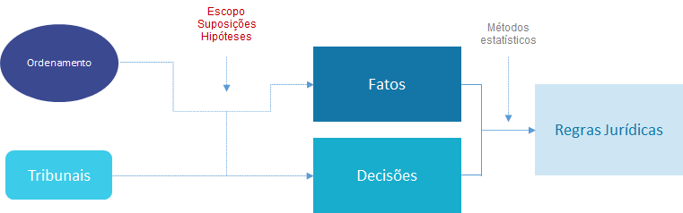
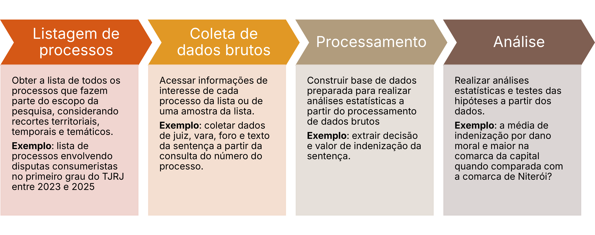
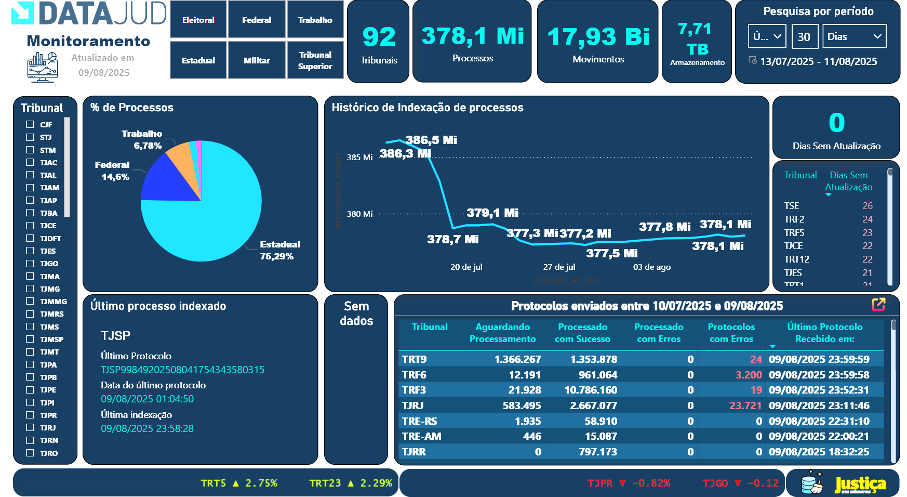
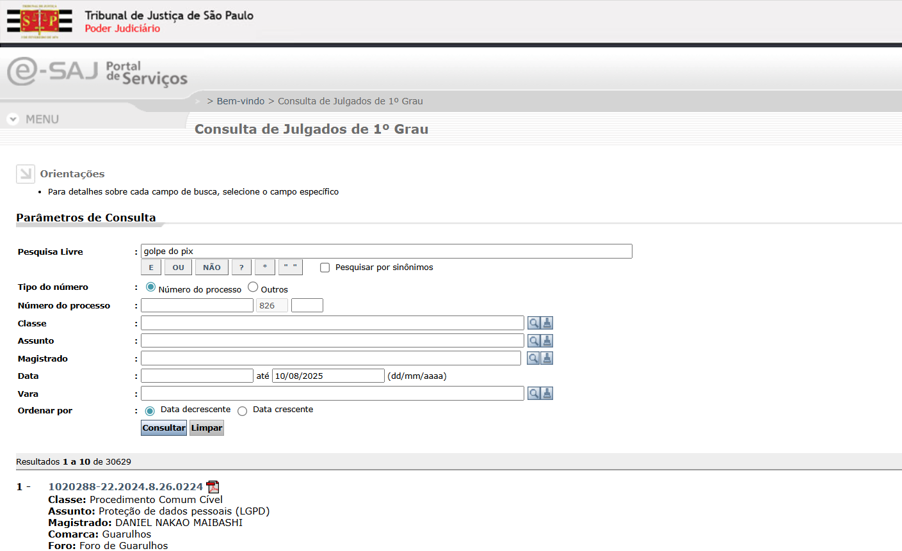
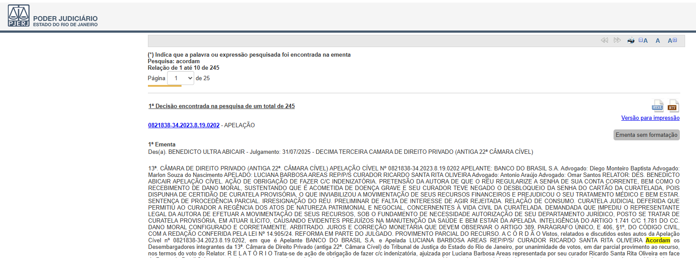
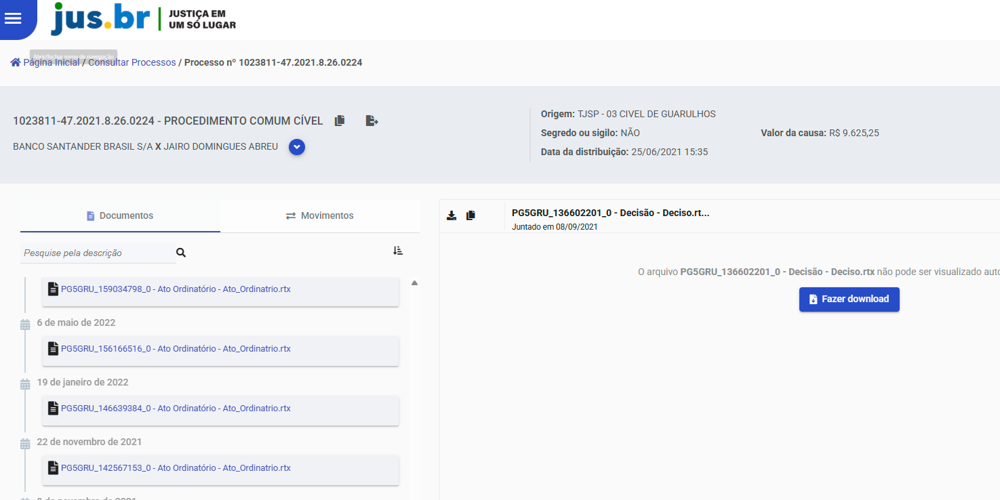
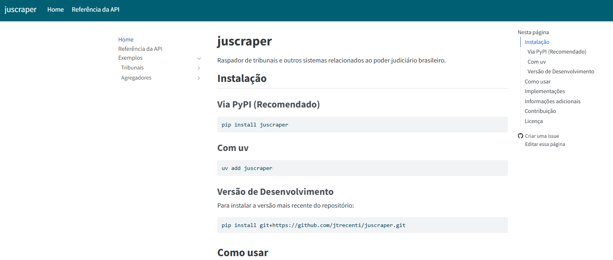
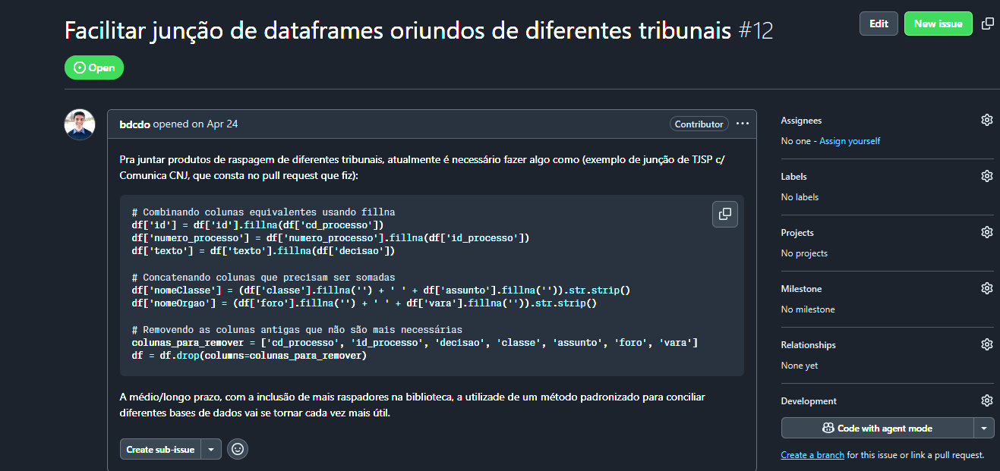
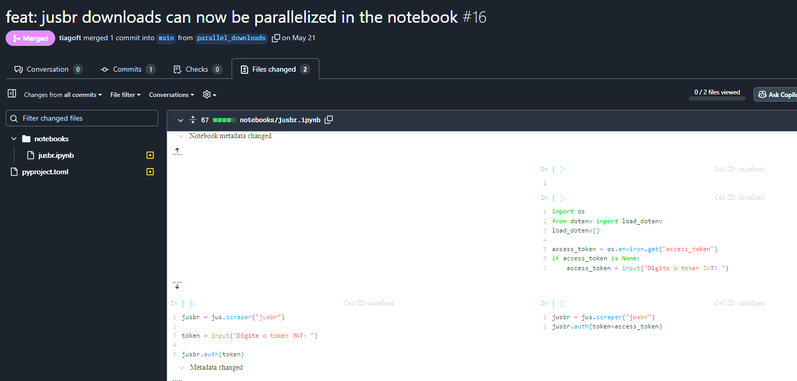

# Contexto

## O que é jurimetria?

Jurimetria é a aplicação da **estatística no direito**. Ela é usada para descobrir **regras jurídicas** a partir das **marcas que o Direito deixa na sociedade**.

{width=75% fig-align="center"}

## Como fazemos uma uma pesquisa jurimétrica?

{width=120% fig-align="center"}

## Sem dados, não há jurimetria

{width="40%" fig-align="center"}

## Dados públicos x Dados abertos

> Dados abertos são dados que podem ser livremente usados, reutilizados e redistribuídos por qualquer pessoa – sujeitos, no máximo, à exigência de atribuição da fonte e compartilhamento pelas mesmas regras.

## Princípios de dados abertos governamentais

1 - **Completos**. Todos os dados públicos estão disponíveis. Dados públicos são dados que não estão sujeitos a limitações válidas de privacidade, segurança ou controle de acesso.

2 - **Primários**. Os dados são apresentados tais como os coletados na fonte, com o maior nível possível de granularidade e sem agregação ou modificação.

3 - **Atuais**. Os dados são disponibilizados o mais rápido possível para preservar o seu valor.

4 - **Acessíveis**. Os dados são disponibilizados para o maior alcance possível de usuários e para os propósitos mais variados possíveis.

# Os dados do judiciário são públicos, mas não são abertos.

. . .

Hoje, existem exceções.

## Datajud

[{width=90% fig-align="center"}](https://www.cnj.jus.br/sistemas/datajud/)

## Dados abertos STJ

[{width=90% fig-align="center"}](https://dadosabertos.web.stj.jus.br/)

## Não é aberto

{width=90% fig-align="center"}

## Não é aberto

{width=90% fig-align="center"}

## Não é aberto

{width=90% fig-align="center"}

# Para cada pesquisa jurimétrica, precisamos implementar robôs para extrair os dados.

# juscraper

## O que é?

ju*s* $\cdot$ scraper

- Ferramenta open source para extração de dados jurídicos.
- Construída para facilitar a coleta de dados do judiciário brasileiro.

## Pessoas contribuindo

::::{.columns}

::: {.column width="50%"}

[{width=100px}](https://github.com/jtrecenti)

[{width=100px}](https://github.com/bcbdo)

:::

:::{.column width="50%"}

[{width=100px}](https://github.com/tiagoft)

[{width=100px}](https://github.com/saylon1986)

:::

::::

## Como funciona

- Escrita em python, visando facilitar o uso por pessoas com pouca experiência em programação.
- Possível de usar diretamente no **Google Colab**, sem necessidade de instalação local.

### Vantagens

- **Flexível**. Permite baixar dados brutos ou processados em tabela.
- **Escalável**. Permite trabalhar com grande volume de dados, ao integrar com ferramentas de paralelização.
- **Modular**. Possui uma arquitetura modular, permitindo adicionar novos tribunais e fontes de dados facilmente.

## Exemplos 1: TJSP



## Exemplo 2: Datajud



## Exemplo 2: jus.br



## Site

::::{.columns}

::: {.column width="80%"}

{width=100% fig-align="center"}

:::

:::{.column width="20%"}



:::

::::

## Limitações atuais

- Foco inicial em agregadores (Datajud e jus.br) e TJSP.
- Ainda falta suporte para outros tribunais e fontes de dados.
- Necessidade de melhorias na documentação e exemplos de uso.
- Uso excessivo de *vibe coding*.

# Colaborando com o projeto

## Documentando problemas

{width=90% fig-align="center"}

## Contribuindo com código

{width=90% fig-align="center"}

## Resumo

- Precidamos de dados para fazer pesquisas jurimétricas.
- Dados do judiciário são públicos, mas não são abertos. Infelizmente, precisamos construir ferramentas para extrair esses dados.
- `juscraper` é uma ferramenta open source para extração de dados jurídicos.
- A ferramenta está em constante evolução, com novas funcionalidades sendo adicionadas regularmente.

## Obrigado! {background-image="img/fox_bye.gif" background-position-y="bottom 100px;" background-size="200px 200px cover"}
