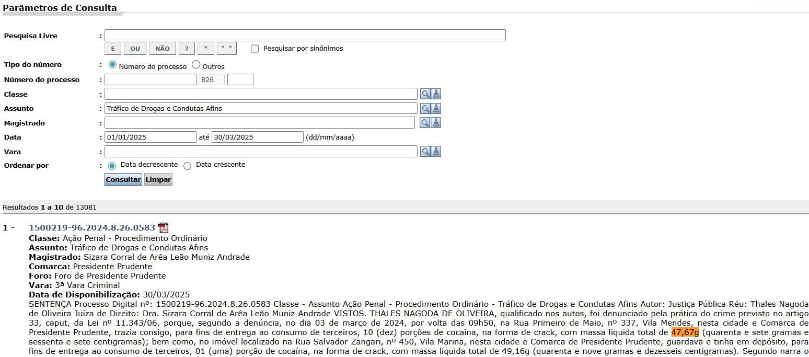
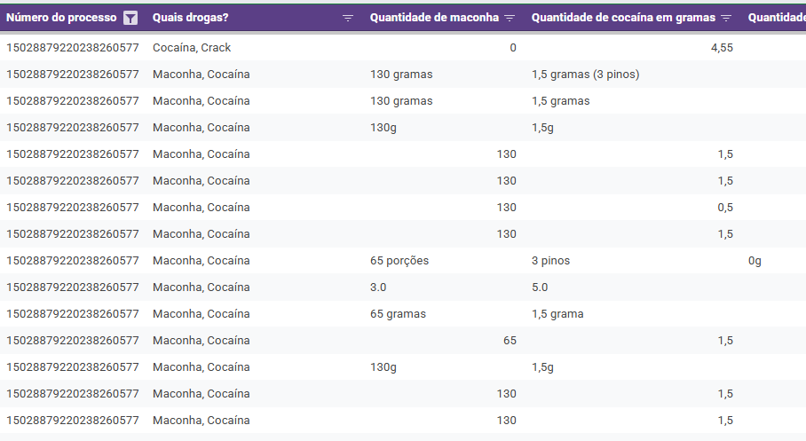
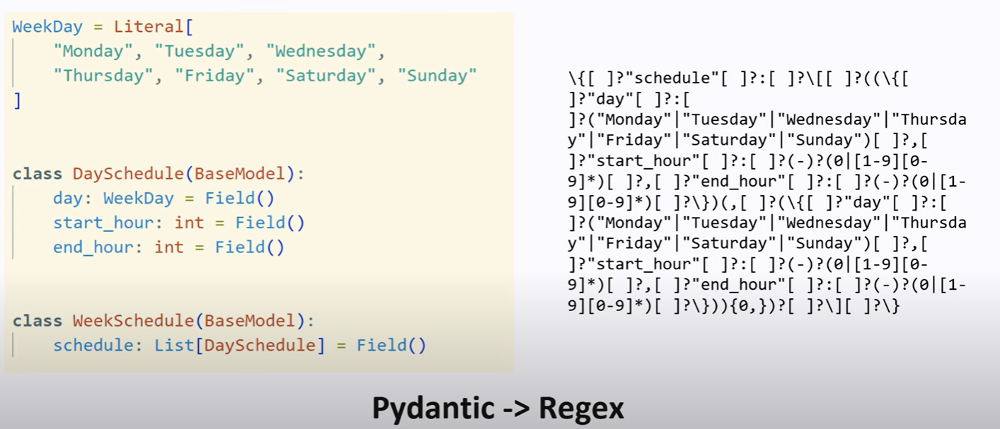
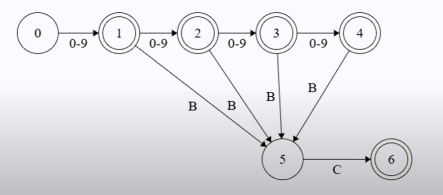
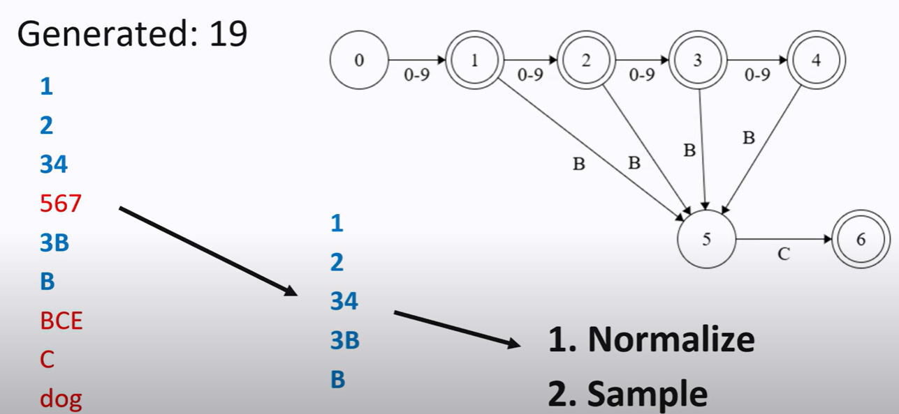
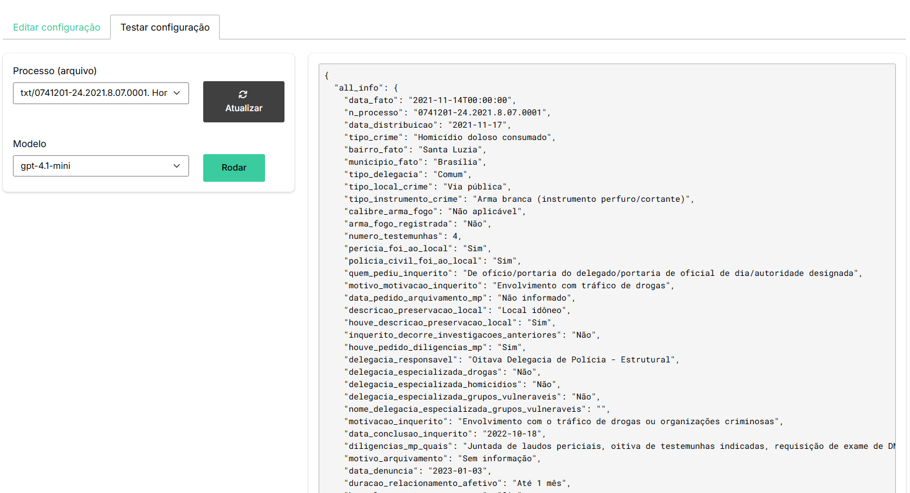

## Julio Trecenti

<style type="text/css">
td {
  vertical-align: center;
}
</style>
<small>Doutor em estatística pelo IME-USP. Mais conhecido como "Marido da [Beatriz Milz](https://beamilz.com)"</small>
<table style="border:none;border-color:none;">
<tr>
<td></td>
<td>Professor no Insper</td>
</tr>
<tr>
<td></td>
<td>Diretor na Associação Brasileira de Jurimetria</td>
</tr>
<tr>
<td></td>
<td>Sócio na Terranova Consultoria</td>
</tr>
<tr>
<td></td>
<td>Pesquisador em Jurimetria no CEOE-Unifesp</td>
</tr>
<tr>
<td></td>
<td>Sócio na Curso-R</td>
</tr>
</table>

# Problema


## Pergunta de pesquisa

Qual é a quantidade de drogas apreendidas (maconha, cocaína e crack) e a decisão judicial (condenação, absolvição ou arquivamento) em sentenças judiciais criminais?

{width=75% fig-align="center"}

## O que queremos

**Anotar dados de sentenças judiciais!!**

{width=75% fig-align="center"}

Ou seja, transformar sentenças judiciais em dados estruturados, para calcular, por exemplo, a distribuição da quantidade de drogas em uma amostra de 100 decisões de primeiro grau no TJSP.

## Como faremos

{fig-align="center"}

## Alternativa 1: na mão

Resultado de um processo manual de anotação:



. . .

**Problema**: Muito trabalho. Difícil de garantir padronização.

## Alternativa 2: expressões regulares (regex)

```
\b((?:\d{1,3}(?:[.\s]\d{3})+|\d+)(?:[.,]\d+)?)
\s*(k(?:g|ilo?s?)|quil(?:o|ogramas?)|g|gr(?:amas?)?|gramas?|m(?:g|iligr(?:amas?)?))(?:\s*(?:brut[oa]|l[ií]quid[oa]))?\s*(?:de|da|do|d[ea]s?)\s*(maconha|cannabis(?:\s+sativa)?|coca[ií]na|crack)\b
```

. . .

**Problema**: não escala bem. É como um modelo de machine learning com overfitting.

## Alternativa 3: machine learning

A partir de uma base anotada, treinar um modelo de machine learning para extrair os dados. Podemos utilizar técnicas como:

**Transformar inputs (textos)**: 

- **Bag of Words**: representar o texto como um vetor de frequências de palavras.
- **Word Embeddings**: representar as palavras em um espaço vetorial contínuo.

**Modelos**:

- Modelos de regressão, árvores de decisão, redes neurais, etc.

. . .

**Problema**: *A partir de uma base anotada*...

## Alternativa 4: LLMs (Large Language Models)

Os modelos são pré-treinados, então podemos apenas pedir no prompt para extrair os dados!

```
Aqui está a síntese solicitada da sentença:

**1) Drogas identificadas**

* **Cocaína**
* **Maconha**
* (Não há menção a crack)

**2) Quantidades apreendidas**

* **Cocaína**: 03 pinos (a sentença não converteu para gramas).
* **Maconha**: 65 porções (também sem especificação em gramas).

**3) Decisão judicial**

* **Condenação**: o réu foi condenado a **5 anos e 10 meses de reclusão em regime inicial fechado**, mais **583 dias-multa**, nos termos do artigo 33, “caput”, c.c. artigo 40, VI, da Lei 11.343/06.

👉 Observação: a sentença não apresenta os pesos em gramas das drogas, apenas o número de porções/pinos.

Quer que eu faça uma versão tabulada (tipo tabela simples) para facilitar a leitura em atividades de extração de informação?
```

## Alternativa 4: LLMs (Large Language Models)

Os modelos são pré-treinados, então podemos apenas pedir no prompt para extrair os dados!

```
Aqui está o resumo solicitado com base na sentença fornecida:

**1) Drogas identificadas:**

* Cocaína
* Maconha

**2) Quantidades:**

* 03 pinos de cocaína (não há indicação em gramas na sentença, apenas a forma de acondicionamento)
* 65 porções de maconha (também sem indicação em gramas na sentença)

**3) Decisão:**

* **Condenação** – o réu foi condenado a 5 anos e 10 meses de reclusão, além de 583 dias-multa, em regime inicial fechado.

Quer que eu estime as quantidades em gramas para cocaína e maconha com base em padrões médios encontrados em jurisprudência e relatórios forenses (por exemplo, peso médio de um pino de cocaína ou de uma porção de maconha), já que a sentença não especifica?
```
. . .

**Problema**: Não há garantia de que ele seguirá certo padrão!

# Solução: Outputs Estruturados

## Como funciona?

::: {.panel-tabset}

### Pydantic

```python
from pydantic import BaseModel

class Resposta(BaseModel):
  maconha: str
  cocaina: str
  crack: str
  qtd_maconha: float
  qtd_cocaina: float
  qtd_crack: float
  decisao: str
  tipo_pena: str
  tempo: float
```

### Prompt

```python
prompt = f"""
Um prompt muito detalhado aqui de como anotar um caso...
"""
```

### Chamada ao modelo

```python
from openai import OpenAI
client = OpenAI()
response = client.responses.create(
  model="gpt-4.1-mini",
  input=[
    {"role": "system", "content": prompt},
    {"role": "user", "content": txt_sentenca}
  ],
  text_format=Resposta
)

resultado = response.output_parsed
```

### Resultado

```python
{
  "maconha": "sim",
  "cocaina": "sim",
  "crack": "não",
  "qtd_maconha": 65.0,
  "qtd_cocaina": 3.0,
  "qtd_crack": 0.0,
  "decisao": "condenado",
  "tipo_pena": "reclusão",
  "tempo": 5.83
}
```

:::

## Categorias: Enum

:::{.panel-tabset}

### Enum

```python
from enum import Enum
class Decisao(str, Enum):
  condenado = "condenado"
  absolvido = "absolvido"
  arquivado = "arquivado"

class TipoPena(str, Enum):
  reclusao = "reclusão"
  detencao = "detenção"
  multa = "multa"
```

### Modelo final

```python
class Resposta(BaseModel):
  maconha: str
  cocaina: str
  crack: str
  qtd_maconha: float
  qtd_cocaina: float
  qtd_crack: float
  decisao: Decisao
  tipo_pena: TipoPena
  tempo: float
```

:::

## No R...


## No R... Hadley Wickham!


## Pacote `{ellmer}`

:::{.panel-tabset}

### Estrutura

```r
library(ellmer)

structured <- type_object(
  maconha = type_string(),
  cocaina = type_string(),
  crack = type_string(),
  qtd_maconha = type_number(),
  qtd_cocaina = type_number(),
  qtd_crack = type_number(),
  decisao = type_enum(c("condenado", "absolvido", "arquivado")),
  tipo_pena = type_enum(c("reclusão", "detenção", "multa")),
  tempo = type_number()
)
```

### Resultado

```r
chat <- chat_openai(model = "gpt-4.1-mini")
chat$chat_structured(
  txt_sentenca,
  type = structured
)
```

:::

# Como funciona (de verdade)?

## Ideia geral

Um modelo de linguagem gera a **probabilidade de cada token**, dada uma sequência de tokens.

. . .

A ideia é **forçar** o modelo a gerar apenas tokens que respeitem a estrutura desejada.

. . .

Isso é feito **em tempo de inferência**, sem necessidade de treinar o modelo.


## Mais técnico

Transformamos o pydantic (ou `{ellmer}`) em uma regex



::: aside

[Structured Output from LLMs: Grammars, Regex, and State Machines](https://www.youtube.com/watch?v=xpvFinvqRCA)

:::

## Máquina de estados finitos (FSM)



. . .

**Teorema**: toda expressão regular pode ser representada por uma FSM!

. . .

Nesse caso, seria `[0-9]{1,4}(BC)?`

::: aside

[Structured Output from LLMs: Grammars, Regex, and State Machines](https://www.youtube.com/watch?v=xpvFinvqRCA)

:::

## Eureka: LLM poder ser guiado por uma FSM!



::: aside

[Structured Output from LLMs: Grammars, Regex, and State Machines](https://www.youtube.com/watch?v=xpvFinvqRCA)

:::

## Aplicação



## Limitações atuais

- Na verdade, um LLM não bate exatamente com a FSM, pois o LLM gera tokens, e não caracteres.
  - Ou seja, na verdade esse é um problema **não resolvido**!

. . .

- As ferramentas atuais de extração de dados estruturados são **limitadas**. Algumas aceitam apenas JSON, outras aceitam tipos mais complexos.

. . .

- Podemos ter uma **degradação na performance**, dependendo do modelo usado e da quantidade de restrições.

# Gostei. Como posso ajudar?

## Pesquisa

- Desenvolver novas técnicas de outputs estruturados que sejam computacionalmente eficientes, sem degradar a performance.
- Desenvolver SLMs (Small Language Models) a partir de bases iniciais de dados anotados.

## Desenvolvimento

- Realizar fine tuning de LLMs para melhorar a qualidade dos outputs estruturados com modelos menores.
- Disponibilizar repositórios, modelos e ferramentas de forma aberta para que outras pessoas possam usar e contribuir.

## Testes e Benchmarks

- Testar diferentes modelos e técnicas de outputs estruturados em tarefas específicas.
- Construir bases de dados anotadas para avaliação.


## Obrigado! {background-image="img/fox_bye.gif" background-position-y="bottom 100px;" background-size="200px 200px cover"}
