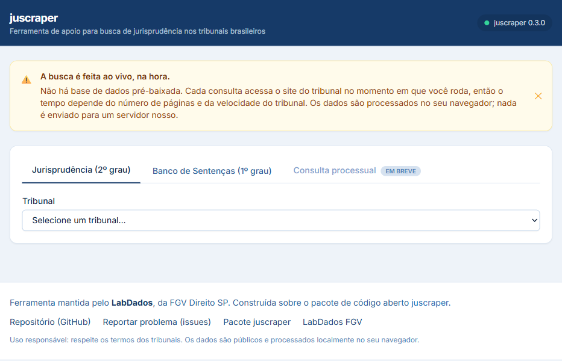
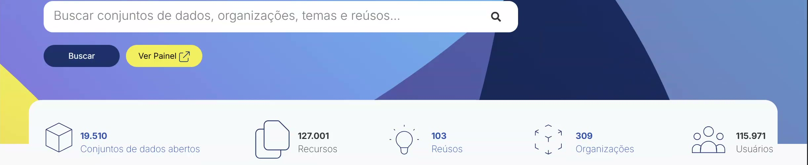
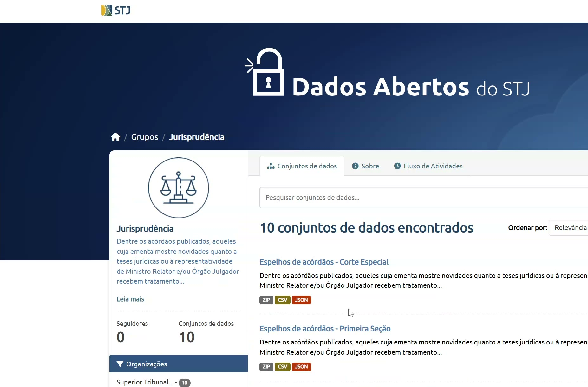
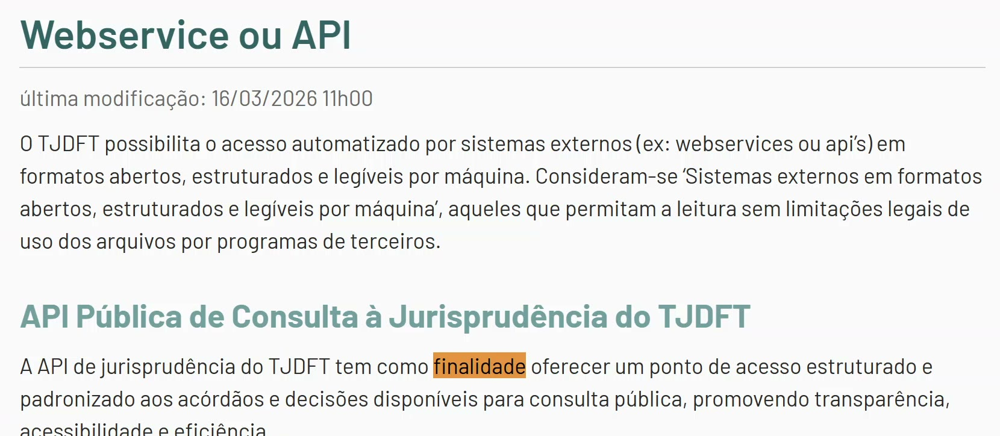
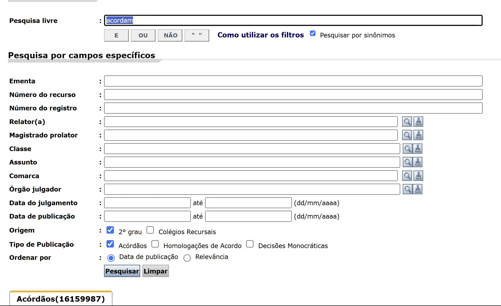

## Estruturar dados ficou fácil, mas acesso e legitimidade seguem em aberto {#roteiro}

::: {.tres}
::: {.fragment .tres-item}
[1]{.tres-n}

**Dá para fazer?**

Estruturar texto judicial ficou fácil e barato.
:::
::: {.fragment .tres-item}
[2]{.tres-n}

**Como acessamos?**

Os grandes repositórios têm portas pagas e estreitas.
:::
::: {.fragment .tres-item}
[3]{.tres-n}

**Podemos fazer?**

Os dados são públicos, mas têm informação pessoal.
:::
:::

::: {.fragment}
Temos a chance de criar bases estruturadas do Judiciário em escala nunca vista.
Talvez seja o projeto mais importante da área agora.
:::

::: notes
**0:00 a 0:40.** Me apresento em uma frase: estatístico, professor no Insper, trabalho com jurimetria desde 2010, hoje também no LabDados da FGV e no CEOE. Anuncio as três perguntas.
:::

## Estruturar textos judiciais ficou fácil {.secao}

## Uma sentença pode virar uma linha de tabela

::: {.sent-grade}
::: {.sent-texto}
"... apreendidos [03 pinos de cocaína]{#s1 .marca} e [65 porções de maconha]{#s2 .marca}
em poder do réu ... Ante o exposto, julgo procedente a denúncia para
[condenar]{#s3 .marca} o acusado à pena de [5 anos e 10 meses de reclusão]{#s4 .marca},
em regime inicial fechado ..."

[Trecho ilustrativo de sentença criminal]{.miudo}
:::

::: {.sent-tabela}
| variável | valor |
|---|---|
| `cocaina_pinos` | [3]{#v1 .val} |
| `maconha_porcoes` | [65]{#v2 .val} |
| `decisao` | [condenado]{#v3 .val} |
| `pena_anos` | [5,83]{#v4 .val} |
:::
:::

[]{.fragment .passo data-passo="s1"}
[]{.fragment .passo data-passo="s2"}
[]{.fragment .passo data-passo="s3"}
[]{.fragment .passo data-passo="s4"}

::: {.fragment}
O Judiciário guarda quase tudo em **texto livre**. A variável que responde à
pergunta de pesquisa quase nunca está nos metadados.
:::

::: notes
**0:40 a 1:30.** Clico quatro vezes: cada trecho do texto vira uma célula.
:::

## Saídas estruturadas reduziram a extração de dados a poucas linhas de código

::: {.etapas}
::: {.etapa .fragment}
**Anotação manual**

Padrão-ouro, mas cara e difícil de padronizar.
:::
::: {.etapa .fragment}
**Expressões regulares**

Funcionam no caso que você viu e quebram no próximo.
:::
::: {.etapa .fragment}
**Machine learning**

Generaliza, mas exige uma base anotada antes.
:::
::: {.etapa .destaque-etapa .fragment}
**LLM com saída estruturada**

Pré-treinado. Você descreve as variáveis e recebe a tabela.
:::
:::

::: {.fragment}
```python
class Sentenca(BaseModel):
    decisao: Literal["condenado", "absolvido", "arquivado"]
    qtd_cocaina: float
    pena_anos: float
```

[O esquema vira uma gramática, e o modelo só pode gerar o que cabe nela. Em Python, [dataframeit](https://github.com/bdcdo/dataframeit); em R, `ellmer`.]{.miudo}
:::

::: notes
**1:30 a 2:40.** Passo rápido. Se perguntarem como funciona: o esquema vira uma máquina de estados que restringe os tokens em tempo de inferência, sem retreinar.
:::

## O Jev responde perguntas fechadas sem gerar texto

::: {.colunas .larga-direita}
::: {}
O **Jev** (TypeSafe AI, setembro de 2026) é um modelo "System One":

- recebe o texto e **perguntas tipadas**;
- devolve só as opções definidas;
- dá uma **probabilidade** para cada resposta.

[Modelo fechado, com acesso por API.]{.miudo}
:::
::: {}
::: {.q-grade}
::: {.q-item .fragment}
[Choice]{.q-tipo}
Qual foi o resultado?
[procedente · 0,97]{.q-resp}
:::
::: {.q-item .fragment}
[Score]{.q-tipo}
Qual a gravidade do dano?
[média · 0,74]{.q-resp}
:::
::: {.q-item .fragment}
[Noul]{.q-tipo}
A sentença decide com base na inversão do ônus?
[sim · 0,52]{.q-resp .incerta}
:::
:::

[Respostas ilustrativas]{.miudo}
:::
:::

::: notes
**2:40 a 3:30.** Três tipos: escolher, posicionar numa escala, sim ou não. O 0,52 diz "não confie em mim aqui". Valores ilustrativos.
:::

## No nosso teste com sentenças do TJSP, o Jev foi mais rápido e o Gemini, mais preciso

::: {#g-bench}
:::

[]{.fragment .passo data-passo="b-lat"}
[]{.fragment .passo data-passo="b-custo"}

::: {#leg-bench .miudo}
12 variáveis fechadas em 120 sentenças cíveis, com gabarito por consenso de modelos fortes e adjudicação cega, sem juristas. [LabDados, set/2026](https://lab-dados.github.io/jev-anotacao-sentencas/).
:::

::: notes
**3:30 a 4:30.** Três estados: qualidade, tempo, custo. Jev cerca de 10 vezes mais rápido, 7 a 26 vezes mais barato.
Se perguntarem sobre confiança: com limiar 0,8, o Jev decidiu sozinho 91% das respostas com 99,3% de acurácia, e os outros 9% iriam para revisão humana.
Dizer em voz alta: o gabarito é de modelos, sem juristas.
:::

## Já existem alternativas abertas ao Jev que rodam na sua própria máquina

| | O que é | Abertura |
|---|---|---|
| **[Kev](https://github.com/jaredpalmer/kev)** | família de modelos tipados sobre Qwen, de 0,8B a 27B, compatível com o SDK do Jev | pesos e treino abertos, Apache-2.0 |
| **[this-that-model](https://arxiv.org/abs/2609.23886)** | modelo tipado de 2 bilhões de parâmetros, cerca de 30 ms em GPU de notebook | pesos no Hugging Face, MIT |
| **[poorjev](https://github.com/rupeshpoojary9/poorjev)** | mesma interface do Jev, com modelo de NLI local | código MIT |
| **LLMs de pesos abertos** | modelo local com saída estruturada (Outlines, Ollama, vLLM) | varia por modelo |

: {.tabela-abertas}

::: {.fragment}
Modelo local significa **texto que não sai de casa**, custo marginal perto de zero e
experimento reproduzível. Mas falta testar essas alternativas em português jurídico:
**esse benchmark ainda está por fazer**.
:::

::: notes
**4:30 a 5:30.** O Kev saiu dois dias depois do Jev e já tem milhares de estrelas no GitHub. Dá para fazer ajuste fino com dados próprios.
Não digo que são melhores: não testamos ainda no LabDados. É um convite.
:::

## Uma oportunidade para a pesquisa empírica em Direito {.secao}

## Já usamos essas ferramentas em pesquisas e em órgãos públicos

::: {#apps}
:::

::: notes
**5:30 a 7:30.** Clico em dois ou três exemplos, não em todos. Teclas 1 a 8 também abrem. Sugestão: PGE (classificação no órgão público, rodando local), Temas 6 e 1234 (pesquisa empírica), IC do Pedro (aluno de graduação faz).
As animações são ilustrativas: nenhuma mostra dados reais.
:::

## O projeto mais importante da área é criar métodos e repositórios abertos

::: {#fluxo}
::: {.f-caixa data-i="0"}
**Coletar**

raspagem e APIs
:::
::: {.f-caixa data-i="1"}
**Estruturar**

esquema e modelo
:::
::: {.f-caixa data-i="2"}
**Validar**

amostra humana, triagem por confiança
:::
::: {.f-caixa data-i="3"}
**Proteger**

anonimizar, publicar variáveis
:::
::: {.f-caixa data-i="4"}
**Abrir**

repositório, licença, documentação
:::
:::

[]{.fragment .passo data-passo="fx"}

::: {.colunas}
::: {.fragment}
**Métodos seguros, baratos e fáceis de usar**, para que pesquisar o Judiciário não dependa de uma equipe de engenharia.
:::
::: {.fragment}
**Repositórios estruturados abertos**, para pesquisadores e sociedade civil, sem que cada grupo refaça tudo do zero.
:::
:::

::: {.fragment}
[Só que há duas perguntas no caminho: como acessamos e se podemos usar.]{.destaque}
:::

::: notes
**7:30 a 8:20.** Falo a tese com todas as letras. Hoje cada grupo paga de novo a mesma coleta e a mesma anotação. Um repositório comum é bem público.
:::

## Como acessamos os dados do Judiciário? {.secao}

## Por muito tempo, pesquisar o Judiciário dependia de papel e de robôs

::: {.linha}
::: {.marco .fragment}
[2010]{.ano}

**Sem base pronta.** No estudo do CARF, aprendi a escrever robôs para baixar decisões.
:::
::: {.marco .fragment}
[2012 a 2014]{.ano}

**LAI em papel.** No estudo de adoção com o CNJ, os dados vieram impressos, e algumas varas negaram acesso.
:::
::: {.marco .fragment}
[Anos 2010]{.ano}

**Um raspador por tribunal.** Cada sistema pedia um código, com paginação, sessões e captchas.
:::
::: {.marco .fragment}
[2020 a 2024]{.ano}

**O CNJ centraliza.** DataJud, PDPJ-Br, Jus.br e, por fim, o data lake.
:::
:::

::: {.fragment}
O passo zero de toda pesquisa empírica em Direito sempre foi **engenharia**, não estatística.
Quem não tinha essa equipe simplesmente não pesquisava com dados.
:::

::: notes
**8:20 a 9:20.** História pessoal, curta. Lição: "público por lei" não é "utilizável na prática". O direito de acesso não é uma base de dados.
:::

## O CNJ passou a concentrar os dados dos tribunais na PDPJ-Br

::: {#arq}
::: {.arq-linha .arq-trib}
[PJe]{.chip} [eproc]{.chip} [e-SAJ]{.chip} [Projudi]{.chip} [outros sistemas]{.chip}
:::
::: {.arq-seta #a1}
Codex extrai dados dos processos eletrônicos
:::
::: {.arq-linha .arq-pdpj #a2}
**PDPJ-Br**, a plataforma que integra os tribunais (Res. CNJ 335/2020), com um **data lake** central
:::
::: {.arq-saidas #a3}
::: {.arq-saida}
**DataJud**

Base nacional de estatísticas (Res. 331/2020), com API pública de metadados
:::
::: {.arq-saida}
**Jus.br**

Portal de serviços (Res. 455/2022), com consulta unificada de processos por login
:::
::: {.arq-saida}
**API do data lake**

Acesso a dados consolidados para instituições (Res. 574/2024 e Portaria 316/2024)
:::
:::
:::

[]{.fragment .passo data-passo="a1"}
[]{.fragment .passo data-passo="a2"}
[]{.fragment .passo data-passo="a3"}

[Esquema simplificado.]{.miudo}

::: notes
**9:20 a 10:30.** Três cliques, de cima para baixo. Antes, cada tribunal com seu sistema. A PDPJ-Br foi a estratégia do CNJ contra essa fragmentação. O Codex é a ferramenta de extração. Dali saem três produtos com públicos diferentes: estatística, serviço ao usuário e venda de acesso.
:::

## Cada caminho de acesso entrega uma parte diferente dos dados

| | O que entrega | Quem usa | Em massa? | Custo |
|---|---|---|---|---|
| **Site do tribunal** | processos e decisões | qualquer pessoa | [não]{.nok} | [grátis]{.ok} |
| **API do DataJud** | só metadados, sem partes, valor nem texto | quem aceita os termos | [120 requisições/min]{.nok} | [grátis]{.ok} |
| **Jus.br** | processo e documentos públicos | usuário com login | [não]{.nok} | [grátis]{.ok} |
| **Data lake PDPJ** | partes e decisões, sem petições | instituições habilitadas | [até 200 milhões/mês]{.ok} | [R\$ 0,0015 a 0,0019 por chamada]{.nok} |

: {.tabela-comp}

::: {.fragment}
O DataJud foi um avanço real para listar casos e sortear amostras. Mas a maior parte
da pesquisa precisa de partes, valores e texto, que estão nos caminhos mais fechados.
:::

::: notes
**10:30 a 11:30.** Leio por linha, sem ler tudo. O contraste: quanto mais rico o dado, mais estreita a porta. Sobre o site do tribunal: é uma tela de busca, um registro por vez, e é daí que vêm os raspadores.
A Portaria 316 exclui petições e documentos do data lake, porque são "potencialmente sensíveis" (art. 4º).
:::

## O acesso completo foi desenhado para grandes instituições

Para usar a API do data lake, a Portaria CNJ 316/2024, art. 5º, exige ao mesmo tempo:

::: {.colunas .larga-esquerda}
::: {}
- políticas de privacidade e proteção de dados;
- infraestrutura de segurança da informação;
- auditoria capaz de reconstruir cada acesso;
- disponibilidade acima de **95%**;
- gestão de identidade para ao menos **200 mil usuários únicos por mês**.

::: {.fragment}
Universidades podem ser dispensadas dos dois últimos itens, a critério da Presidência do CNJ. Pesquisadores individuais não estão cobertos.
:::
:::
::: {}
::: {.fragment}
::: {.numerao}
R\$ 1 mil a 35 mil
<small>por mês, em planos de uma API privada que revende dados judiciais públicos (abril de 2026)</small>
:::
:::
:::
:::

::: notes
**11:30 a 12:30.** O dado é público; o que se tornou privado foi o acesso. O problema não são as empresas agregarem valor, é não existir a camada pública por baixo.
:::

## Enquanto isso, a comunidade liberta os dados por conta própria

::: {.colunas .larga-esquerda}
::: {}
Libertar dados é capturar, limpar, estruturar e publicar:

- [`juscraper`](https://github.com/jtrecenti/juscraper): raspadores abertos para mais de 25 tribunais, DataJud e Jus.br
- [`juscraper-app`](https://lab-dados.github.io/juscraper-app/): o mesmo, sem programar
- **JudeData** (USP): dados do STF em CSV documentado
- **Brasil.IO**, **Base dos Dados** e **Querido Diário**: a linhagem brasileira

::: {.fragment}
Raspar resolve uma pesquisa, não a infraestrutura. Isso exige governança, fôlego e
**colaboração dos tribunais**.
:::
:::
::: {}

:::
:::

::: notes
**12:30 a 13:20.** Raspagem é método de pesquisa, não invasão. Mas é o plano B: o certo é a instituição abrir. Transição: e, conseguindo acessar, podemos usar?
:::

## Podemos usar esses dados em pesquisa? {.secao}

## Dado público não é o mesmo que dado aberto

::: {.colunas}
::: {}
::: {.caixa .caso}
[Dado público]{.rotulo}

Qualquer pessoa pode **acessar**. Em geral, um registro por vez, numa tela de busca.
:::
::: {.caixa .ideia}
[Dado aberto]{.rotulo}

Qualquer pessoa pode **acessar, usar, modificar e compartilhar para qualquer finalidade**,
em formato aberto, legível por máquina e sob licença aberta.

[Open Knowledge Foundation, Open Definition]{.miudo}
:::
:::
::: {}


[`dados.gov.br`: mais de 19 mil conjuntos. A política federal é referência, mas alcança o Executivo, não o Judiciário.]{.miudo}

::: {.fragment}
**Todo dado público deveria ser aberto?**
:::
:::
:::

::: notes
**13:20 a 14:10.** "Clicar e baixar" é o critério prático. A política do Executivo Federal não obriga o Judiciário, mas nada impede o Judiciário de abrir.
:::

## O próprio CNJ trata sentenças e nomes das partes como dados públicos

> "dados públicos: dados estruturados e não estruturados relativos a número único, classe e assuntos do processo, nome das partes e de seus advogados, decisões, sentenças, votos e acórdãos [...]"

[Portaria CNJ 316/2024, art. 2º, I, remetendo à Res. CNJ 121/2010]{.miudo}

::: {.fragment}
Ou seja, o dado é público **e** contém informação pessoal. A pergunta não é se ele é
acessível, mas **em que condições** pode ser reutilizado.
:::

::: notes
**14:10 a 14:40.** Citação curta, leio em voz alta. Petições e documentos são "potencialmente sensíveis" e ficam de fora; processos em segredo são "restritos".
:::

## O STJ e o TJDFT já publicam decisões como dados abertos

::: {.colunas}
::: {}
**STJ**: espelhos de acórdãos



[ZIP, CSV e JSON, com licença CC-BY. `dadosabertos.web.stj.jus.br`]{.miudo}
:::
::: {.fragment}
**TJDFT**: API pública de jurisprudência



> "sem limitações legais de uso dos arquivos por programas de terceiros"

[`tjdft.jus.br`, Transparência, Webservice ou API]{.miudo}
:::
:::

::: notes
**14:40 a 15:30.** Primeiro o STJ: qualquer pessoa ou máquina baixa os espelhos. Tribunal superior, então talvez seja prerrogativa?
Clico: não, o TJDFT é tribunal de justiça, "tão filho de Deus quanto o TJSP", e publica API aberta. Essas decisões também têm dados pessoais.
:::

## O TJSP tem dados públicos, mas não abertos

::: {.colunas .larga-direita}
::: {}
- A consulta é **pública**, sem cadastro.
- Não há download em massa nem licença aberta.
- Busque **"PIX"**: aparecem chaves que são CPFs.

::: {.fragment}
As **empresas** de consulta processual já baixaram tudo. Quem esbarra é a **pesquisa**, que pode travar no comitê de ética.
:::
:::
::: {}


[Consulta de jurisprudência do TJSP, com 16.159.987 acórdãos listados (out/2026).]{.miudo}
:::
:::

::: notes
**15:30 a 16:15.** Não mostro nenhum CPF. Cito a busca como provocação. O dado pessoal já está exposto a qualquer pessoa, e o único ator contido é o pesquisador.
:::

## A mesma decisão pode ser aberta ou não, dependendo do tribunal

| | STJ | TJDFT | TJSP |
|---|---|---|---|
| Decisões públicas | sim | sim | sim |
| Têm dados pessoais | sim | sim | sim |
| Acesso por máquina oficial | [sim]{.ok} | [sim]{.ok} | [não]{.nok} |
| Licença aberta | [CC-BY]{.ok} | [uso sem limitação legal]{.ok} | [não]{.nok} |

: {.tabela-comp}

::: {.colunas}
::: {.fragment}
::: {.caixa .ideia}
[Primeiro caminho]{.rotulo}

São públicos, logo **deveriam ser abertos**. O TJSP só está atrasado, e a pesquisa é legítima.
:::
:::
::: {.fragment}
::: {.caixa .atencao}
[Segundo caminho]{.rotulo}

Têm dados pessoais, logo **pedem comitê de ética**. Mas aí a resposta muda com o tribunal.
:::
:::
:::

::: {.fragment .centro}
[Mudar de tribunal não deveria mudar o que é ético pesquisar.]{.destaque}
:::

::: notes
**16:15 a 17:10.** Provocação do bloco. Não digo que o segundo caminho é errado: digo que ele precisa ser coerente.
:::

## Podemos abrir os dados em camadas, conforme o risco

::: {.camadas}
::: {.camada .c1 .fragment}
**Aberta**

Variáveis estruturadas e metadados, sem identificar pessoas, para qualquer finalidade.
:::
::: {.camada .c2 .fragment}
**Protegida**

Textos anonimizados, com finalidade declarada e termo de uso.
:::
::: {.camada .c3 .fragment}
**Restrita**

Dados identificados e cruzamentos, em sala segura e com comitê de ética.
:::
:::

::: {.fragment}
Estruturar também protege: a base publica `decisao` e `pena_anos`, e não o texto. E a mesma IA ajuda a anonimizar.
:::

::: {.fragment .miudo}
LGPD, art. 7º, §3º (finalidade, boa-fé e interesse público) e inciso IV (pesquisa). Res. CNS 510/2016, art. 1º, parágrafo único (informações de acesso público).
:::

::: notes
**17:10 a 18:10.** Resposta a "podemos?": sim, com desenho. Nem tudo aberto, nem tudo trancado.
Exemplo real: no benchmark, as sentenças integrais não são redistribuídas, só metadados e anotações. Já o estudo de saúde, que cruza CPF com bases administrativas, foi para o comitê de ética.
Não é parecer jurídico: é uma proposta para o debate.
:::

## O que precisamos de tribunais, comitês e universidades {.pedidos}

::: {.pedido .fragment}
[Tribunais e CNJ]{.ped-q}
Publiquem em massa, com licença aberta. STJ e TJDFT mostram que dá.
:::
::: {.pedido .fragment}
[Comitês e reguladores]{.ped-q}
Deem critérios coerentes para pesquisa com dado público, independentes do tribunal.
:::
::: {.pedido .fragment}
[Pesquisa e universidades]{.ped-q}
Construam juntos métodos validados e repositórios abertos, com modelos que possamos auditar.
:::

::: {.fragment .centro .fecho}
Dado público só é público de verdade quando é aberto.
:::

::: notes
**18:10 a 19:30.** Fecho devagar. Recapitulo: dá para fazer, o acesso é o gargalo e podemos usar com desenho por camadas.
:::

## Obrigado! {.fim}

::: {.colunas .meio}
::: {}
**Julio Trecenti**

`julioazt@insper.edu.br`

[Slides e código abertos no repositório de slides. Redigido com apoio do Claude Code (Claude Opus 5.5). As afirmações e eventuais erros são meus.]{.miudo}
:::
::: {}
::: {.qrs}
::: {}
{.limpo}

[estes slides]{.miudo}
:::
::: {}
{.limpo}

[juscraper]{.miudo}
:::
::: {}
{.limpo}

[juscraper-app]{.miudo}
:::
:::
:::
:::

::: notes
**19:30 a 20:00.** Agradeço e deixo os QR codes na tela durante as perguntas.
:::
