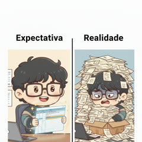
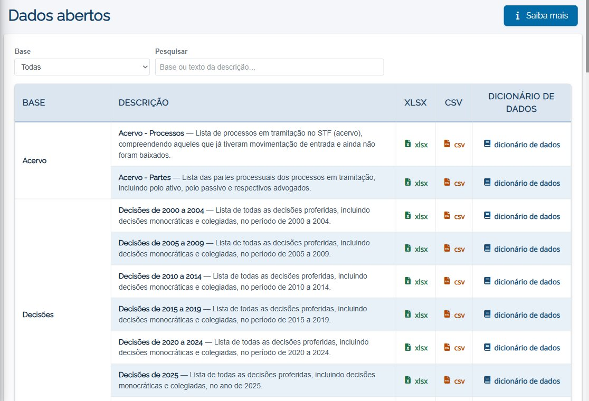
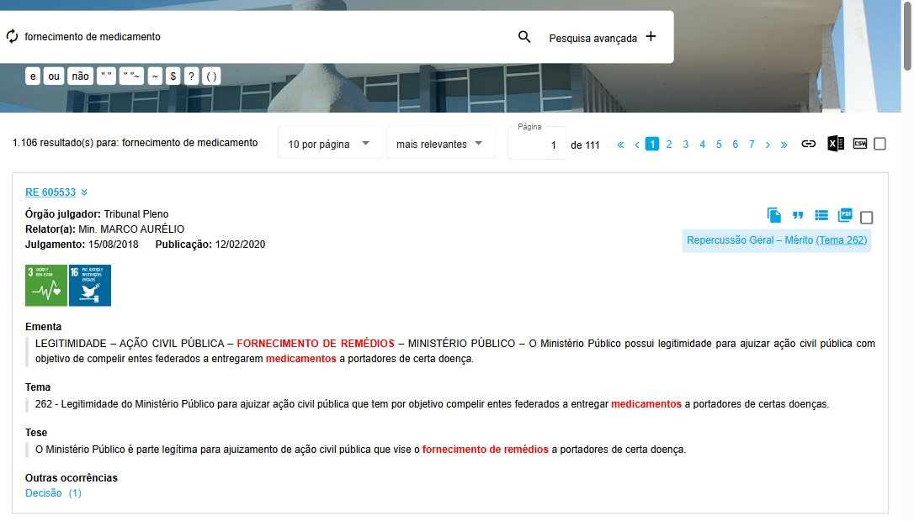
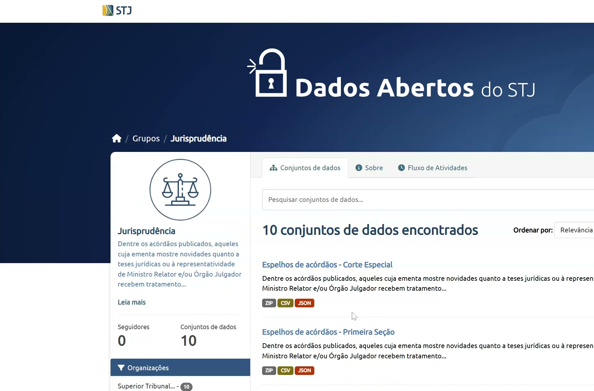
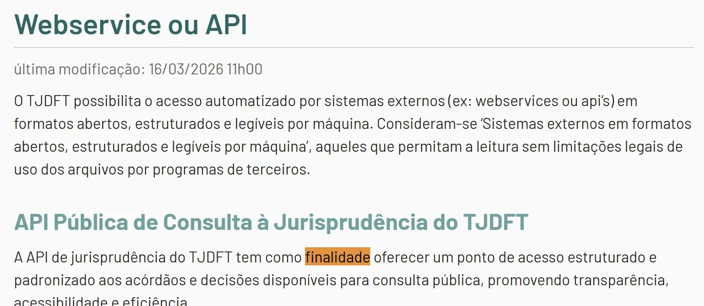
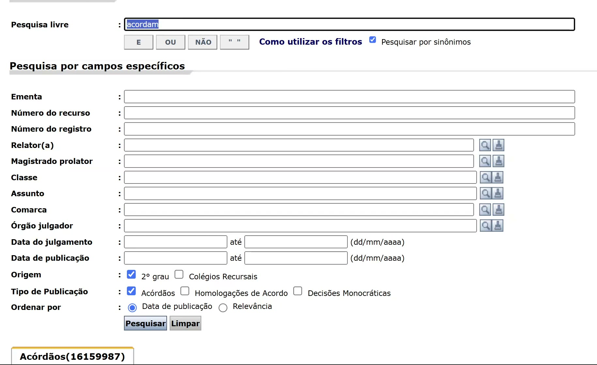

## Estruturar dados ficou fácil, mas acesso e abertura seguem em aberto {#roteiro}

::: {.tres}
::: {.fragment .tres-item}
[1]{.tres-n}

**Dá para fazer?**

Estruturar texto judicial ficou fácil e barato.
:::
::: {.fragment .tres-item}
[2]{.tres-n}

**Como acessamos?**

Os dados existem, mas raramente em massa e com o texto.
:::
::: {.fragment .tres-item}
[3]{.tres-n}

**Podemos abrir?**

Os dados são públicos, mas têm informação pessoal.
:::
:::

::: {.fragment}
Temos a chance de criar bases estruturadas do Judiciário em escala nunca vista, e o
STF tem um papel especial nisso.
:::

::: notes
**0:00 a 1:30.** Agradeço o convite do programa Estratégia em movimento. Anuncio as três perguntas. Antes delas, três minutos sobre de onde eu falo.
:::

## De onde eu falo {.secao}

## Trabalho com dados do Judiciário em três lugares {#quem}

::: {.quem-grade}
::: {.quem-card data-i="0"}
[Insper]{.quem-nome}

Professor de ciência de dados aplicada ao Direito, na graduação em Direito.
:::
::: {.quem-card data-i="1"}
[LabDados, FGV Direito SP]{.quem-nome}

Pesquisador no laboratório de dados e pesquisa empírica em Direito.
:::
::: {.quem-card data-i="2"}
[CEOE, Unifesp]{.quem-nome}

Pesquisador.
:::
:::

::: {.quem-linha}
[desde 2010]{.ql-ano} [jurimetria: doutor em estatística pelo IME-USP, escrevendo raspadores de tribunais e modelos para dados judiciais]{.ql-txt}
:::

[]{.fragment .passo data-passo="q0"}
[]{.fragment .passo data-passo="q1"}
[]{.fragment .passo data-passo="q2"}

::: notes
**1:30 a 2:30.** Três cliques. Sou estatístico, trabalho com jurimetria desde 2010. O fio comum: transformar processos em dados para responder perguntas sobre o sistema de justiça.
:::

## No Insper, ensinamos ciência de dados com problemas jurídicos reais {#insper}

::: {.colunas .larga-esquerda}
::: {}
::: {#trilha}
:::

[Ciência de Dados Aplicada ao Direito, na graduação em Direito do Insper]{.miudo}
:::
::: {}
::: {.ins-num .fragment}
[8]{.ins-n}
projetos aplicados, com apps no navegador e feedback automático
:::
::: {.ins-num .fragment}
[14]{.ins-n}
grupos em pesquisa de campo: sobrevivência, Delphi, conjoint, análise de conteúdo
:::
::: {.ins-num .fragment}
[1]{.ins-n}
livro aberto: [jtrecenti.github.io/cdad-book](https://jtrecenti.github.io/cdad-book)
:::
:::
:::

[]{.fragment .passo data-passo="cd"}

::: notes
**2:30 a 4:00.** Um clique desenha a trilha da disciplina, da estatística à IA e à LGPD, sempre com dados de tribunais. Depois, três números da turma de 2026.
Também orientamos iniciação científica e projetos com órgãos públicos, como a PGE-SP (aparecem adiante).
:::

## O LabDados organiza a pesquisa empírica em Direito na FGV Direito SP {#labdados}

::: {.colunas .larga-direita}
::: {}
Laboratório de Dados e Pesquisa Empírica em Direito, criado em **abril de 2026**, com
coordenação do Prof. Daniel Wang.

[As ferramentas são meio; o fim é qualificar a pesquisa empírica.]{.destaque}

Ciência aberta: código aberto e métodos documentados.
:::
::: {}
::: {#frentes}
:::
:::
:::

[]{.fragment .passo data-passo="lf"}

::: notes
**4:00 a 5:00.** Um clique faz as cinco frentes orbitarem o laboratório: pesquisa e publicações, formação, escritório de apoio à pesquisa, tecnologias, parcerias.
:::

## Ferramentas abertas do LabDados {#ferramentas}

::: {.colunas .larga-esquerda}
::: {}
::: {#mapa-js}
:::

[`juscraper` 0.5.0 (out/2026): raspadores e clientes de API em Python]{.miudo}
:::
::: {}
::: {.ferr .fragment}
**dataframeit**: estrutura textos com LLM, linha a linha
:::
::: {.ferr .fragment}
**QualiLab**: análise qualitativa assistida por IA
:::
::: {.ferr .fragment}
**raspe**: fontes oficiais do Executivo e do Legislativo
:::
::: {.ferr .fragment}
**juscraper-app** e **juscraper-mcp**: o mesmo, sem programar ou dentro de um assistente
:::
:::
:::

[]{.fragment .passo data-passo="js1"}
[]{.fragment .passo data-passo="js2"}

::: notes
**5:00 a 6:00.** Dois cliques: primeiro acendem os 32 tribunais cobertos, incluindo o STF; depois os 5 agregadores (DataJud, Jus.br, Comunica, PDPJ, Falcão). Ao lado, as outras ferramentas.
:::

## Plano do LabDados para 2027 {#plano}

::: {.plano-grade}
::: {.plano-card .fragment}
[Publicar]{.pl-t}
Seis artigos submetidos com revisão por pares, de preferência internacionais.
:::
::: {.plano-card .fragment}
[Saúde e STF]{.pl-t}
Do pré-registro às análises confirmatórias do efeito dos Temas 6 e 1234.
:::
::: {.plano-card .fragment}
[Formar]{.pl-t}
Curso de programação, curso de QualiLab e workshops na pós.
:::
::: {.plano-card .fragment}
[Apoiar]{.pl-t}
Chamada anual de projetos, com regras claras de autoria.
:::
::: {.plano-card .fragment}
[Estabilizar]{.pl-t}
Segurança, testes e documentação; lançamento formal do `juscraper`.
:::
::: {.plano-card .fragment}
[Parcerias]{.pl-t}
Novas frentes com sociedade civil e universidades estrangeiras.
:::
:::

[Plano em discussão com a coordenação.]{.miudo}

::: notes
**6:00 a 7:00.** Passo rápido, uma frase por cartão. O cartão de saúde é o gancho com o STF: estamos medindo o efeito de precedentes do próprio Supremo.
:::

## Estruturar textos judiciais ficou fácil {.secao}

## Uma decisão do STF pode virar uma linha de tabela

::: {.sent-grade}
::: {.sent-texto}
"[RE 605533]{#s1 .marca} ... LEGITIMIDADE, AÇÃO CIVIL PÚBLICA,
[FORNECIMENTO DE REMÉDIOS]{#s2 .marca}, MINISTÉRIO PÚBLICO. O Ministério Público
[possui legitimidade]{#s3 .marca} para ajuizar ação civil pública com objetivo de
compelir entes federados a entregarem medicamentos a portadores de certa doença."

[Tema 262]{#s4 .marca} · Tribunal Pleno · julgado em 15/08/2018

[Ementa pública, do portal de jurisprudência do STF]{.miudo}
:::

::: {.sent-tabela}
| variável | valor |
|---|---|
| `classe` | [RE]{#v1 .val} |
| `assunto` | [saúde]{#v2 .val} |
| `resultado_mp` | [favorável]{#v3 .val} |
| `tema_rg` | [262]{#v4 .val} |
:::
:::

[]{.fragment .passo data-passo="s1"}
[]{.fragment .passo data-passo="s2"}
[]{.fragment .passo data-passo="s3"}
[]{.fragment .passo data-passo="s4"}

::: {.fragment}
O Judiciário guarda quase tudo em **texto livre**. Aqui a classe e o tema estão nos
metadados, mas o **sentido da decisão** só está no texto.
:::

::: notes
**7:00 a 8:00.** Quatro cliques, cada trecho vira uma célula. Ementa curta e pública. Num acórdão inteiro, as variáveis interessantes (fundamentos, divergência, modulação) estão espalhadas por dezenas de páginas.
:::

## Saídas estruturadas reduziram a extração de dados a poucas linhas de código

::: {.etapas}
::: {.etapa .fragment}
**Anotação manual**

Padrão-ouro, mas cara e difícil de padronizar.
:::
::: {.etapa .fragment}
**Expressões regulares**

Funcionam no caso que você viu e quebram no próximo.
:::
::: {.etapa .fragment}
**Machine learning**

Generaliza, mas exige uma base anotada antes. Foi o caminho do VICTOR.
:::
::: {.etapa .destaque-etapa .fragment}
**LLM com saída estruturada**

Pré-treinado. Você descreve as variáveis e recebe a tabela.
:::
:::

::: {.fragment}
```python
class Acordao(BaseModel):
    assunto: Literal["saúde", "tributário", "previdenciário", "outro"]
    resultado: Literal["provido", "desprovido", "não conhecido"]
    modulacao_efeitos: bool
```

[O esquema vira uma gramática, e o modelo só pode gerar o que cabe nela. Em Python, [dataframeit](https://github.com/bdcdo/dataframeit); em R, `ellmer`.]{.miudo}
:::

::: notes
**8:00 a 9:30.** O VICTOR, de 2018, é exemplo da terceira etapa: precisou de milhares de recursos anotados para treinar. Hoje, para muitas perguntas, basta escrever o esquema.
Se perguntarem como funciona: o esquema vira uma máquina de estados que restringe os tokens em tempo de inferência, sem retreinar.
:::

## O Jev responde perguntas fechadas sem gerar texto

::: {.colunas .larga-direita}
::: {}
O **Jev** (TypeSafe AI, setembro de 2026) é um modelo "System One":

- recebe o texto e **perguntas tipadas**;
- devolve só as opções definidas;
- dá uma **probabilidade** para cada resposta.

[Modelo fechado, com acesso por API.]{.miudo}
:::
::: {}
::: {.q-grade}
::: {.q-item .fragment}
[Choice]{.q-tipo}
Qual foi o resultado do recurso?
[desprovido · 0,97]{.q-resp}
:::
::: {.q-item .fragment}
[Score]{.q-tipo}
Quão extensa é a fundamentação constitucional?
[média · 0,74]{.q-resp}
:::
::: {.q-item .fragment}
[Noul]{.q-tipo}
A decisão modula os efeitos?
[sim · 0,52]{.q-resp .incerta}
:::
:::

[Respostas ilustrativas]{.miudo}
:::
:::

::: notes
**9:30 a 10:30.** Três tipos: escolher, posicionar numa escala, sim ou não. O 0,52 diz "não confie em mim aqui". Valores ilustrativos.
:::

## No nosso teste com sentenças do TJSP, o Jev foi mais rápido e o Gemini, mais preciso

::: {#g-bench}
:::

[]{.fragment .passo data-passo="b-lat"}
[]{.fragment .passo data-passo="b-custo"}

::: {#leg-bench .miudo}
12 variáveis fechadas em 120 sentenças cíveis, com gabarito por consenso de modelos fortes e adjudicação cega, sem juristas. [LabDados, set/2026](https://lab-dados.github.io/jev-anotacao-sentencas/).
:::

::: notes
**10:30 a 11:30.** Três estados: qualidade, tempo, custo. Jev cerca de 10 vezes mais rápido, 7 a 26 vezes mais barato.
Dizer em voz alta: o gabarito é de modelos, sem juristas.
:::

## A confiança do modelo decide o que vai para revisão humana {#triagem}

::: {#g-tri}
:::

::: {.legendas-tri}
::: {.leg-tri}
Cada ponto é uma resposta do modelo no benchmark, posicionada pela confiança que ele declarou.
:::
::: {.leg-tri}
Com um limiar de **0,8**, o que fica à direita é aceito sem revisão.
:::
::: {.leg-tri}
**91%** das respostas passam direto, com **99,3%** de acurácia. Os outros **9%** vão para uma pessoa.
:::
:::

[]{.fragment .passo data-passo="c1"}
[]{.fragment .passo data-passo="c2"}

[Pontos dispostos para ilustrar as proporções do benchmark do Jev (limiar 0,8).]{.miudo}

::: notes
**11:30 a 12:45.** Esse é o slide que interessa a quem decide adotar IA: não é "a máquina faz tudo", é "a máquina diz quando não sabe". Isso conversa com o que o próprio STF diz das suas ferramentas: supervisão e revisão humana.
:::

## Já existem alternativas abertas ao Jev que rodam na sua própria máquina

| | O que é | Abertura |
|---|---|---|
| **[Kev](https://github.com/jaredpalmer/kev)** | família de modelos tipados sobre Qwen, de 0,8B a 27B, compatível com o SDK do Jev | pesos e treino abertos, Apache-2.0 |
| **[this-that-model](https://arxiv.org/abs/2609.23886)** | modelo tipado de 2 bilhões de parâmetros, cerca de 30 ms em GPU de notebook | pesos no Hugging Face, MIT |
| **[poorjev](https://github.com/rupeshpoojary9/poorjev)** | mesma interface do Jev, com modelo de NLI local | código MIT |
| **LLMs de pesos abertos** | modelo local com saída estruturada (Outlines, Ollama, vLLM) | varia por modelo |

: {.tabela-abertas}

::: {.fragment}
Modelo local significa **texto que não sai de casa**, custo marginal perto de zero e
experimento reproduzível. Para um tribunal, isso pesa tanto quanto a acurácia.
:::

::: notes
**12:45 a 13:45.** Não digo que são melhores: ainda não testamos em português jurídico. O ponto para o STF: dá para ter IA de estruturação sem mandar processo para fora.
:::

## Uma oportunidade para a pesquisa e para a gestão {.secao}

## O STF já usa IA em várias frentes {#ia-stf}

::: {#tl-ia}
::: {.tl-trilho}
:::
::: {.tl-item data-i="0"}
[2018]{.ano}

[VICTOR]{.tl-cnj}

Identifica temas de repercussão geral em recursos extraordinários.
:::
::: {.tl-item data-i="1"}
[2022]{.ano}

[RAFA]{.tl-cnj}

Classifica processos pelos objetivos da Agenda 2030 da ONU.
:::
::: {.tl-item data-i="2"}
[2023]{.ano}

[VitorIA]{.tl-cnj}

Agrupa processos por semelhança; no Tema 1.261, achou 247 recursos.
:::
::: {.tl-item data-i="3"}
[2024]{.ano}

[MARIA]{.tl-cnj}

Primeira IA generativa: resumos de votos, relatórios, Reclamações.
:::
::: {.tl-item data-i="4"}
[2026]{.ano}

[Shield]{.tl-cnj}

Detecta comandos ocultos em petições (ARE 1608713).
:::
:::

[]{.fragment .passo data-passo="i0"}
[]{.fragment .passo data-passo="i1"}
[]{.fragment .passo data-passo="i2"}
[]{.fragment .passo data-passo="i3"}
[]{.fragment .passo data-passo="i4"}

::: {.fragment}
Todas trabalham com o **texto completo** dos processos. Fora do tribunal, a pesquisa
quase sempre só tem os metadados.
:::

[Fontes: notícias do STF de 16/12/2024, 25/09/2025, 25/09/2026 e 28/09/2026.]{.miudo}

::: notes
**13:45 a 15:15.** Cinco cliques. Vocês conhecem essas ferramentas melhor do que eu; o ponto é o contraste. A RAFA aparece até na pesquisa pública de jurisprudência: os selos dos ODS ao lado de cada acórdão.
A Maria Shield (set/2026) mostra que IA também cria riscos novos: prompt injection numa petição, com multa aplicada pelo relator.
:::

## Já usamos essas ferramentas em pesquisas e em órgãos públicos

::: {#apps}
:::

::: notes
**15:15 a 18:00.** Clico em três ou quatro exemplos. Teclas 1 a 7 também abrem. Começar pelos Temas 6 e 1234 (precedentes do STF), depois a auditoria eleitoral, a PGE (órgão público, rodando local) e o TCU (da extração ao documento).
As animações são ilustrativas: nenhuma mostra dados reais.
:::

## O projeto mais importante da área é criar métodos e repositórios abertos

::: {#fluxo}
::: {.f-caixa data-i="0"}
**Coletar**

raspagem e APIs
:::
::: {.f-caixa data-i="1"}
**Estruturar**

esquema e modelo
:::
::: {.f-caixa data-i="2"}
**Validar**

amostra humana, triagem por confiança
:::
::: {.f-caixa data-i="3"}
**Proteger**

anonimizar, publicar variáveis
:::
::: {.f-caixa data-i="4"}
**Abrir**

repositório, licença, documentação
:::
:::

[]{.fragment .passo data-passo="fx"}

::: {.colunas}
::: {.fragment}
**Métodos seguros, baratos e fáceis de usar**, para que pesquisar o Judiciário não dependa de uma equipe de engenharia.
:::
::: {.fragment}
**Repositórios estruturados abertos**, para pesquisadores, imprensa e sociedade civil, sem que cada grupo refaça tudo do zero.
:::
:::

::: {.fragment}
[Só que há duas perguntas no caminho: como acessamos e se podemos abrir.]{.destaque}
:::

::: notes
**18:00 a 19:00.** Falo a tese com todas as letras. Hoje cada grupo paga de novo a mesma coleta e a mesma anotação. Um repositório comum é bem público.
:::

## Como acessamos os dados do Judiciário? {.secao}

## Por muito tempo, pesquisar o Judiciário dependia de papel e de robôs

::: {#tl}
::: {.tl-trilho}
:::
::: {.tl-item data-i="0"}
[2010]{.ano}

{.tl-foto .limpo}

**Sem base pronta.** No estudo do CARF, aprendi a escrever robôs.
:::
::: {.tl-item data-i="1"}
[2012]{.ano}

{.tl-foto .limpo}

**LAI em papel.** No estudo de adoção, os dados vieram impressos.
:::
::: {.tl-item data-i="2"}
[2014]{.ano}

{.tl-foto .limpo}

**Um raspador por tribunal**, com sessões e captchas.
:::
::: {.tl-item data-i="3"}
[2016]{.ano}

{.tl-foto .limpo}

**Dados abertos** chegam ao Executivo, não ao Judiciário.
:::
::: {.tl-item data-i="4"}
[2020 a 2024]{.ano}

[CNJ]{.tl-cnj}

**O CNJ centraliza** com DataJud, PDPJ-Br e Jus.br.
:::
:::

[]{.fragment .passo data-passo="t0"}
[]{.fragment .passo data-passo="t1"}
[]{.fragment .passo data-passo="t2"}
[]{.fragment .passo data-passo="t3"}
[]{.fragment .passo data-passo="t4"}

::: {.fragment}
O passo zero da pesquisa empírica em Direito sempre foi **engenharia**, não estatística.
:::

::: notes
**19:00 a 20:15.** Cinco cliques, um por marco. História pessoal, curta. Lição: "público por lei" não é "utilizável na prática". O direito de acesso não é uma base de dados.
:::

## O CNJ passou a concentrar os dados dos tribunais na PDPJ-Br

::: {#arq}
::: {.arq-linha .arq-trib}
[PJe]{.chip} [eproc]{.chip} [e-SAJ]{.chip} [Projudi]{.chip} [outros sistemas]{.chip}
:::
::: {.arq-seta #a1}
Codex extrai dados dos processos eletrônicos
:::
::: {.arq-linha .arq-pdpj #a2}
**PDPJ-Br**, a plataforma que integra os tribunais (Res. CNJ 335/2020), com um **data lake** central
:::
::: {.arq-saidas #a3}
::: {.arq-saida}
**DataJud**

Base nacional de estatísticas (Res. 331/2020), com API pública de metadados
:::
::: {.arq-saida}
**Jus.br**

Portal de serviços (Res. 455/2022), com consulta unificada de processos por login
:::
::: {.arq-saida}
**API do data lake**

Acesso a dados consolidados para instituições habilitadas, pago por chamada (Portaria 316/2024)
:::
:::
:::

[]{.fragment .passo data-passo="a1"}
[]{.fragment .passo data-passo="a2"}
[]{.fragment .passo data-passo="a3"}

::: {.fragment}
O **STF não está sob o CNJ** (ADI 3.367) e mantém sistemas próprios. Os dados do
Supremo seguem outro caminho: o **Corte Aberta**.
:::

::: notes
**20:15 a 21:30.** Três cliques, de cima para baixo, e a ressalva. Antes, cada tribunal com seu sistema; a PDPJ-Br foi a estratégia do CNJ contra a fragmentação. Dali saem três produtos com públicos diferentes: estatística, serviço ao usuário e venda de acesso.
O data lake exige da instituição, entre outros, gestão de identidade para 200 mil usuários por mês e cobra R$ 0,0015 a 0,0019 por chamada (Portaria 316, art. 5º). Não afirmo se o STF envia dados ao DataJud: não encontrei confirmação.
:::

## O STF em números, pelo Corte Aberta {#numeros}

::: {.colunas}
::: {}
::: {.num-grade}
::: {.num-card}
[21636]{.num-v data-fmt="int"}
processos em tramitação
:::
::: {.num-card}
[110832]{.num-v data-fmt="int"}
decisões em 2026, até agora
:::
::: {.num-card}
[1502]{.num-v data-fmt="int"}
temas de repercussão geral apreciados
:::
::: {.num-card}
[5.4]{.num-v data-fmt="pct"}
taxa atual de provimento recursal
:::
:::

[Painéis do Corte Aberta, consultados em 25/11/2026. Atualização diária.]{.miudo}
:::
::: {}
::: {#waffle}
:::

::: {#waffle-leg .miudo}
Em 2025, **94.934 decisões monocráticas**, cerca de 80% do total (Relatório de Atividades 2025).
:::
:::
:::

[]{.fragment .passo data-passo="n1"}
[]{.fragment .passo data-passo="n2"}

::: notes
**21:30 a 22:45.** Primeiro clique: os contadores sobem até os valores do painel de ontem. Segundo: o quadro de cem quadradinhos mostra que quatro em cada cinco decisões são monocráticas.
Pergunta para a plateia: que pergunta de gestão vocês responderiam com isso? E qual precisaria do texto?
:::

## O Corte Aberta publica bases para download {#bases}

::: {.colunas .larga-direita}
::: {}


[`transparencia.stf.jus.br`, Dados abertos: XLSX, CSV e dicionário de dados. Programa criado pela Res. STF 774/2022.]{.miudo}
:::
::: {}
::: {#gran}
:::
:::
:::

[]{.fragment .passo data-passo="g1"}
[]{.fragment .passo data-passo="g2"}

::: notes
**22:45 a 24:00.** É um avanço real, e mais do que muitos tribunais oferecem: acervo, decisões desde 2000, recebidos e baixados, repercussão geral, controle concentrado, reclamações, plenário virtual, pautas.
Dois cliques: primeiro as bases encaixam nas três granularidades (processo, decisão, parte). Depois aparece a coluna que falta: o texto da decisão.
:::

## Cada caminho de acesso ao STF entrega uma parte diferente dos dados {#portas}

| | O que entrega | Em massa? | Termos de uso |
|---|---|---|---|
| **Painéis do Corte Aberta** | estatísticas agregadas | não se aplica | não localizados |
| **Bases do Corte Aberta** | processos, decisões e partes, [sem o texto]{#e-meta .realce} | sim, CSV e XLSX | não localizados |
| **Pesquisa de jurisprudência** | ementas e inteiro teor | [um resultado por vez]{#e-lim .realce} | [não localizados]{#e-inst .realce} |
| **Acompanhamento processual** | andamentos e peças públicas | [um processo por vez]{#e-custo .realce} | não localizados |

: {.tabela-comp}

[]{.fragment .passo data-passo="r0"}
[]{.fragment .passo data-passo="r1"}
[]{.fragment .passo data-passo="r2"}
[]{.fragment .passo data-passo="r3"}
[]{.fragment .passo data-passo="e-dj"}
[]{.fragment .passo data-passo="e-pd"}

::: {.fragment}
O metadado já é aberto. O **texto**, que é onde a IA agrega valor, só sai um a um, e
o acesso automatizado não tem regras públicas.
:::

::: notes
**24:00 a 25:30.** Uma linha por clique, depois duas ênfases: falta o texto nas bases; e o texto só sai um a um, sem termos de uso que digam o que é permitido.
Cuidado ao falar: a pesquisa de jurisprudência tem uma API interna não documentada, e o portal fica atrás de um firewall de aplicação. Não é proibição, é ausência de regra clara. Não encontrei Plano de Dados Abertos nem API documentada; digo "não localizei", não "não existe".
:::

## Enquanto isso, a comunidade constrói bases do STF por conta própria

::: {.colunas .larga-esquerda}
::: {}
- **Base de votos do STF** (Insper e Southampton): 2 milhões de votos e 423 mil decisões desde 1988
- **Supremo em Números** (FGV Direito Rio): relatórios até 2020
- [`juscraper`](https://github.com/jtrecenti/juscraper): módulo do STF, além de mais 31 tribunais
- **JudeData** (USP) e pacotes em R: dados do STF em formato documentado

::: {.fragment}
Raspar resolve uma pesquisa, não a infraestrutura. Cada grupo refaz a coleta, com
regras diferentes e sem saber se está incomodando o tribunal.
:::
:::
::: {}


[Pesquisa de jurisprudência do STF, com os selos de ODS da RAFA ao lado do acórdão.]{.miudo}
:::
:::

::: notes
**25:30 a 26:45.** A base de votos foi noticiada pela Pesquisa FAPESP em abril de 2025. A mesma matéria aponta limites: os dados mostram os vencidos, mas não quem formou a maioria, e o plenário virtual não registra os debates.
Raspagem é método de pesquisa, não invasão. Mas é o plano B: o certo é a instituição abrir.
:::

## Podemos abrir esses dados? {.secao}

## Dado público não é o mesmo que dado aberto

::: {.colunas}
::: {}
::: {#morfo .caixa .caso}
[Dado público]{#mf-rot .rotulo}

::: {#mf-texto}
:::

[Open Knowledge Foundation, Open Definition]{#mf-fonte .miudo}
:::
:::
::: {}


[`dados.gov.br`: mais de 19 mil conjuntos. A política federal é referência, mas alcança o Executivo, não o Judiciário.]{.miudo}

[]{.fragment .passo data-passo="mf"}

::: {.fragment}
**Todo dado público deveria ser aberto?**
:::
:::
:::

::: notes
**26:45 a 28:00.** Um clique transforma a definição de dado público na de dado aberto. "Clicar e baixar" é o critério prático. As bases do Corte Aberta já cumprem boa parte disso para metadados; falta a licença explícita e o texto.
:::

## O CNJ trata sentenças e nomes das partes como dados públicos

> "dados públicos: dados estruturados e não estruturados relativos a número único, classe e assuntos do processo, nome das partes e de seus advogados, decisões, sentenças, votos e acórdãos [...]"

[Portaria CNJ 316/2024, art. 2º, I, remetendo à Res. CNJ 121/2010]{.miudo}

::: {.fragment}
A norma não vincula o STF, mas a ideia vale para todo o Judiciário: o dado é público
**e** contém informação pessoal. A pergunta não é se ele é acessível, mas **em que
condições** pode ser reutilizado.
:::

::: notes
**28:00 a 29:00.** Citação curta, leio em voz alta. Petições e documentos são "potencialmente sensíveis" e ficam de fora do data lake; processos em segredo são "restritos".
:::

## Como os tribunais têm tratado esses dados

::: {.colunas}
::: {}
**STJ**: espelhos de acórdãos



[ZIP, CSV e JSON, com licença CC-BY. `dadosabertos.web.stj.jus.br`]{.miudo}
:::
::: {.fragment}
**TJDFT**: API pública de jurisprudência



> "sem limitações legais de uso dos arquivos por programas de terceiros"

[`tjdft.jus.br`, Transparência, Webservice ou API]{.miudo}
:::
:::

::: notes
**29:00 a 30:15.** Primeiro o STJ: qualquer pessoa ou máquina baixa os espelhos, com licença. Clico: o TJDFT, tribunal de justiça, publica API aberta. Essas decisões também têm dados pessoais.
:::

## O TJSP tem dados públicos, mas não abertos

::: {.colunas .larga-direita}
::: {}
- A consulta é **pública**, sem cadastro.
- Não há download em massa nem licença aberta.
- Busque **"PIX"**: aparecem chaves que são CPFs.

::: {.fragment}
As **empresas** de consulta processual já baixaram tudo. Quem esbarra é a **pesquisa**, que pode travar no comitê de ética.
:::
:::
::: {}


[Consulta de jurisprudência do TJSP, com 16.159.987 acórdãos listados (out/2026).]{.miudo}
:::
:::

::: notes
**30:15 a 31:15.** Não mostro nenhum CPF. Cito a busca como provocação. O dado pessoal já está exposto a qualquer pessoa, e o único ator contido é o pesquisador.
:::

## A mesma decisão pode ser aberta ou não, dependendo do tribunal {#comp}

| | STJ | TJDFT | TJSP | STF |
|---|---|---|---|---|
| Decisões públicas | sim | sim | sim | sim |
| Têm dados pessoais | sim | sim | sim | sim |
| Metadados em massa | [sim]{.ok} | [sim]{.ok} | [não]{.nok} | [sim, Corte Aberta]{.ok #c-stf1} |
| Texto em massa | [sim]{.ok} | [sim]{.ok} | [não]{.nok} | [não]{.nok #c-stf2} |
| Licença ou termos de uso | [CC-BY]{.ok} | [uso sem limitação legal]{.ok} | [não]{.nok} | [não localizados]{.nok #c-stf3} |

: {.tabela-comp}

[]{.fragment .passo data-passo="cs"}

::: {.colunas}
::: {.fragment}
::: {.caixa .ideia}
[Primeiro caminho]{.rotulo}

São públicos, logo **deveriam ser abertos**. Quem não abre só está atrasado.
:::
:::
::: {.fragment}
::: {.caixa .atencao}
[Segundo caminho]{.rotulo}

Têm dados pessoais, logo **pedem cuidado**. Mas aí a resposta não pode mudar com o tribunal.
:::
:::
:::

::: notes
**31:15 a 32:45.** Um clique acende a coluna do STF: ele está no meio do caminho, melhor que o TJSP nos metadados, atrás do STJ e do TJDFT no texto. Mudar de tribunal não deveria mudar o que é ético pesquisar.
:::

## Podemos abrir os dados em camadas, conforme o risco

::: {.camadas}
::: {.camada .c1 .fragment}
**Aberta**

Variáveis estruturadas e metadados, sem identificar pessoas, para qualquer finalidade.
:::
::: {.camada .c2 .fragment}
**Protegida**

Textos anonimizados, com finalidade declarada e termo de uso.
:::
::: {.camada .c3 .fragment}
**Restrita**

Dados identificados e cruzamentos, em sala segura e com comitê de ética.
:::
:::

::: {.fragment}
Estruturar também protege: a base publica `resultado` e `tema_rg`, e não o texto. E a
mesma IA que estrutura ajuda a anonimizar.
:::

::: {.fragment .miudo}
LGPD, art. 7º, §3º (finalidade, boa-fé e interesse público) e inciso IV (pesquisa). Res. CNS 510/2016, art. 1º, parágrafo único (informações de acesso público).
:::

::: notes
**32:45 a 34:15.** Resposta a "podemos?": sim, com desenho. Nem tudo aberto, nem tudo trancado.
Exemplo real: no benchmark, as sentenças integrais não são redistribuídas, só metadados e anotações. Já o estudo de saúde, que cruza dados com bases administrativas, passou pelo comitê de ética.
Não é parecer jurídico: é uma proposta para o debate.
:::

## A transparência também vale para as ferramentas de IA {#ficha}

::: {.colunas .larga-esquerda}
::: {}
::: {#ficha-ia .caixa .ideia}
[Ficha de uma ferramenta de IA]{.rotulo}

::: {#ficha-linhas}
:::
:::
:::
::: {}
::: {.fragment}
As notícias do STF descrevem **para que** cada ferramenta serve e reforçam a
**supervisão humana**.
:::

::: {.fragment}
Uma ficha pública com dados de treino, métricas e auditorias permitiria que a
pesquisa ajudasse a **avaliar** essas ferramentas.
:::
:::
:::

[]{.fragment .passo data-passo="fi"}

::: notes
**34:15 a 35:30.** Um clique preenche a ficha campo a campo, com marcas do que já é público (finalidade, supervisão) e do que ainda não encontrei (métricas, auditoria). A própria notícia de 28/09/2026 sobre a VitorIA diz que os relatórios não trazem taxa de acerto.
Tom: proposta construtiva, não crítica. Abrir avaliação é o que dá legitimidade às ferramentas.
:::

## O que o STF pode fazer agora {.pedidos}

::: {.pedido .fragment}
[Texto]{.ped-q}
Publicar o inteiro teor das decisões em lote, ao lado das bases do Corte Aberta.
:::
::: {.pedido .fragment}
[Regras]{.ped-q}
Documentar a API de jurisprudência, com limites e termos de uso, e uma licença aberta.
:::
::: {.pedido .fragment}
[Votos]{.ped-q}
Estruturar os votos do Plenário Virtual: quem acompanhou quem.
:::
::: {.pedido .fragment}
[IA]{.ped-q}
Publicar fichas das ferramentas, com métricas e auditorias.
:::
::: {.pedido .fragment}
[Pesquisa]{.ped-q}
Abrir um canal com universidades para validar métodos e repositórios.
:::

::: {.fragment .centro .fecho}
Dado público só é público de verdade quando é aberto.
:::

::: notes
**35:30 a 38:00.** Fecho devagar. O Corte Aberta já mostrou que o STF sabe abrir dados; a proposta é dar o próximo passo. Recapitulo: dá para fazer, o acesso é o gargalo e podemos abrir com desenho por camadas.
Restante do tempo: perguntas.
:::

## Obrigado! {.fim}

::: {.colunas .meio}
::: {}
**Julio Trecenti**

`julioazt@insper.edu.br`

[Slides e código abertos no repositório de slides. Redigido com apoio do Claude Code (Claude Opus 5.5). As afirmações e eventuais erros são meus.]{.miudo}
:::
::: {}
::: {.qrs}
::: {}
{.limpo}

[estes slides]{.miudo}
:::
::: {}
{.limpo}

[juscraper]{.miudo}
:::
::: {}
{.limpo}

[juscraper-app]{.miudo}
:::
:::
:::
:::

::: notes
**38:00 em diante.** Agradeço e deixo os QR codes na tela durante as perguntas.
:::
